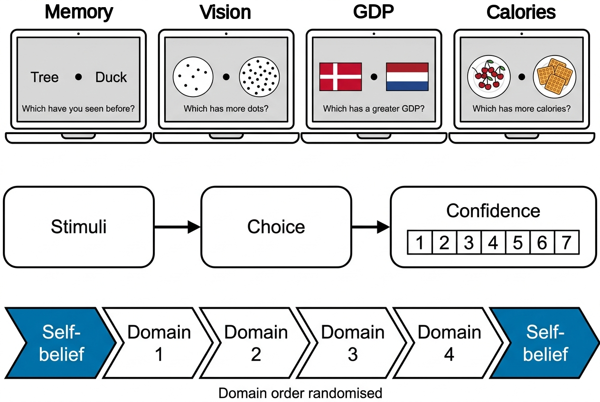
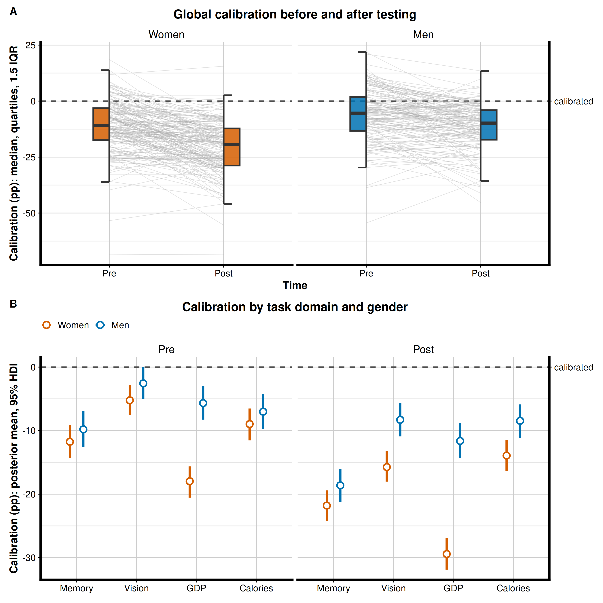
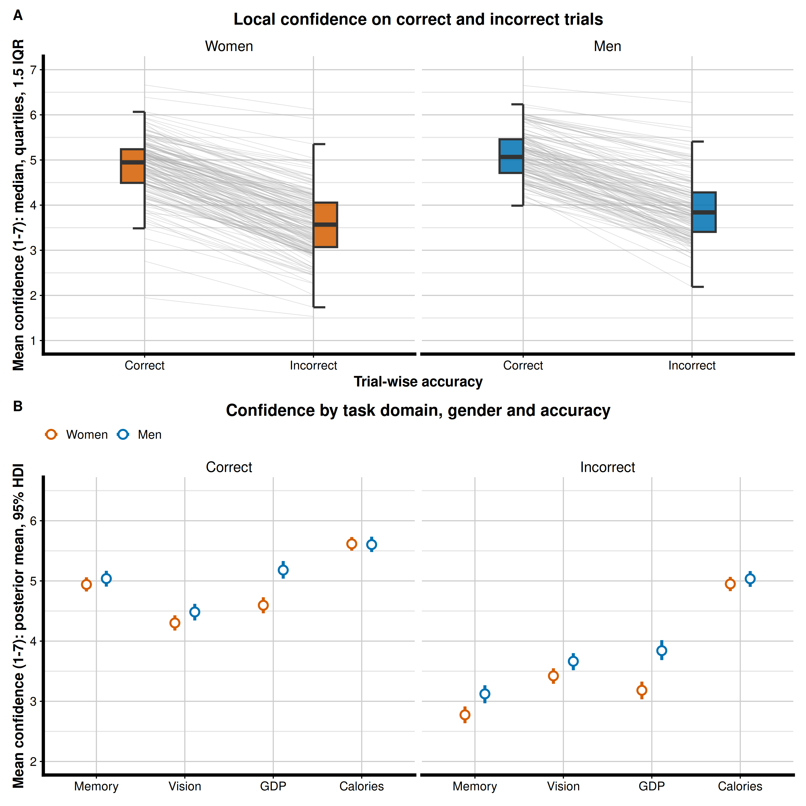
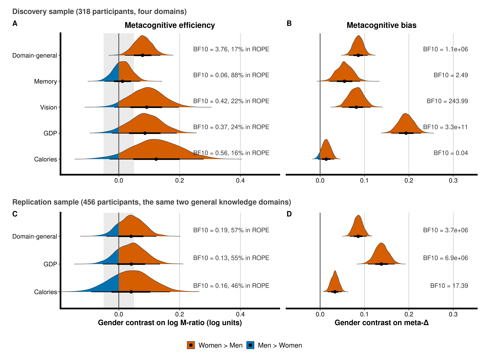

# Women set a higher bar for confidence: a domain-graded gender difference in local and global metacognitive bias

**Kelly Hoogervorst<sup>1</sup>, Leah Banellis<sup>1</sup>, Francesca Fardo<sup>1,2</sup>, Kai Xue<sup>3</sup>, Dobromir Rahnev<sup>3</sup>, Micah Allen<sup>1,4</sup>**

_<sup>1</sup>Center of Functionally Integrative Neuroscience, Aarhus University, Aarhus, Denmark_
_<sup>2</sup>Danish Pain Research Center, Aarhus University, Aarhus, Denmark_
_<sup>3</sup>School of Psychological and Brain Sciences, Georgia Institute of Technology, Atlanta, GA, USA_
_<sup>4</sup>Cambridge Psychiatry, Cambridge University, Cambridge, UK_

Revised manuscript for *Communications Psychology* (major revision, 2026). The original preprint is at
[osf.io/preprints/psyarxiv/2gwky](https://osf.io/preprints/psyarxiv/2gwky); the revision changes the
analysis and the conclusions, as summarised below.

## Abstract

Metacognition is the ability to monitor our own cognitive and perceptual processes. Gender differences in
self-confidence are well documented, but it is unclear whether they reflect a difference in how confidence
is expressed (metacognitive bias) or in how well confidence tracks performance (metacognitive efficiency).
We tested 317 participants on recognition memory, visual perception and two general-knowledge domains,
each with trial-wise confidence ratings and with explicit self-beliefs about performance collected before
and after testing, and we replicated the general-knowledge measures in an independent sample of 456
participants. Bias was measured against a reference point: global calibration (self-estimated minus
actual per cent correct) and meta-Δ, the placement of confidence criteria relative to the metacognitive
decision criterion, estimated within a single hierarchical signal-detection model. Both genders
under-estimated their accuracy, women by seven percentage points more than men, and women revised their
self-beliefs further downward after testing. At the trial level women placed their confidence criteria
more conservatively than men at matched accuracy, by the same amount in both samples, on correct as well
as incorrect trials. The difference was domain-graded: in the same direction in every domain, but ranging from near zero for
nutritional knowledge to large for socioeconomic knowledge. Metacognitive efficiency showed at most a small advantage for women: moderate evidence in the first
sample, and an estimate in the same direction but too imprecise to distinguish from zero in the
replication. The robust gender difference in metacognition is therefore in where the confidence criteria
are placed, with any difference in metacognitive sensitivity small by comparison.

## What changed in the revision

- **Bias is measured as bias.** Raw self-belief is replaced by calibration (self-estimate minus actual
  accuracy), and mean confidence is replaced by meta-Δ from the hierarchical model.
- **One Bayesian framework.** Every ANOVA and t-test is replaced by a brms multilevel model; every effect
  is reported with a 95% HDI, a Savage–Dickey Bayes factor and a ROPE percentage. Metacognitive efficiency
  and bias come from a single hierarchical meta-d′ model (hmetad, brms, Stan) fitted to all participants
  and domains with gender on every parameter, instead of separately fitted groups whose posteriors were
  subtracted.
- **An independent replication.** 456 participants from the Visceral Mind Project completed the same GDP
  and Calories tasks on the same seven-point scale.
- **Conclusions.** The bias result holds and replicates (meta-Δ women − men = +0.086 in both samples).
  The efficiency advantage for women reported in the preprint is small in the first sample
  (log M-ratio +0.08 [0.02, 0.14], BF10 = 3.8) and in the same direction but imprecise in the replication
  (+0.04 [−0.04, 0.12]); it is described as possible but not established and is no longer a claim of the
  paper. The error-sensitivity claim is withdrawn.

## Figures

### Figure 1. Multi-domain metacognitive test battery

_Top: one trial per domain (memory, vision, trivia GDP, trivia calories). Middle: every trial was a
two-alternative choice followed by a confidence rating from 1 to 7. Bottom: self-beliefs about expected
per cent correct were collected before and after the battery; domain order was randomised._

### Figure 2. Global calibration by gender

_(A) Calibration (self-estimated minus actual per cent correct) before and after testing, averaged over
domains; grey lines are participants, half boxplots show median, quartiles and 1.5 IQR whiskers. Zero is
calibrated. (B) Model-implied calibration per domain, gender and time, posterior mean with 95% HDI.
Everyone under-estimates; women by 6.6 pp [4.4, 8.8] more than men, and their post-test update is more
negative by 3.8 pp [1.6, 5.9] (BF10 = 135)._

### Figure 3. Local confidence by gender and trial accuracy

_(A) Mean confidence on correct and incorrect trials, averaged over domains. (B) Model-implied confidence
per domain, gender and accuracy with each participant's task accuracy as a covariate. Women report lower
confidence at matched accuracy (−0.27 [−0.41, −0.14] scale points), on correct as well as incorrect
trials; the gender × accuracy interaction is inconclusive here (BF10 = 1.9) and null in the replication
(BF01 = 5.6)._

### Figure 4. Gender contrasts on efficiency and bias from the unified hierarchical meta-d′ model

_Top: first sample (318 participants, four domains). Bottom: replication (456 participants, GDP and
Calories). Left: women − men on log M-ratio with the ±0.05 ROPE shaded. Right: women − men on meta-Δ; a
positive value means women place their confidence criteria more conservatively. Labels give BF10 and, for
log M-ratio, the percentage of the posterior inside the ROPE. Axes are shared within a column._

### Supplementary figures
[S1 accuracy by gender](revision/figures/FigureS1_accuracy.png) ·
[S2 reaction time by gender](revision/figures/FigureS2_rt.png) ·
[S3 local confidence in the replication sample](revision/figures/FigureS3_vmp_confidence.png) ·
[S4 relative-criterion robustness fit](revision/figures/FigureS4_metad_relative.png) ·
[S5 reaction-time and staircase checks](revision/figures/FigureS5_rt_staircase.png) ·
[S6 posterior predictive check, first sample](revision/figures/ppc/fe_fixed/fe_fixed_ppc_confidence_by_accuracy.png) ·
[S7 posterior predictive check, replication](revision/figures/ppc/vmp_fixed/vmp_fixed_ppc_confidence_by_accuracy.png)

## Repository layout

```
data/            trial-level data and self-belief questionnaires (first sample)
figures/         figures from the original preprint
revision/        the revised analysis: everything in the current manuscript is produced here
  code/          numbered plain-R scripts, one per step (prep, fit, effects, figures, tables)
  data/          derived data: prepared trial tables, effects_*.csv, prior sensitivity, PPC, QC
  figures/       Figures 1–4 and S1–S7 with caption text files
  README.md      how to run the pipeline, model definition, priors, compute notes
  VMP_REPLICATION.md  the replication sample and how it was prepared
```

The analysis is run in order: `01`/`01b` prepare the two samples, `03_fit_unified.R` fits the hierarchical
model (on a SLURM cluster; `revision/code/slurm/`), `04`–`09` produce PPC, effects, subject estimates,
convergence and prior sensitivity, `20`–`29` are the behavioural brms models, `fig*` draw the figures and
`30_manuscript_tables.R` writes every table in the paper from the CSVs. See `revision/README.md` and
`revision/code/README_behavioural.md`.

## Contributors

- **Kelly Hoogervorst**, lead author: data wrangling, analysis, writing
- **Leah Banellis**: analysis and writing; Visceral Mind Project data collection
- **Francesca Fardo**: analysis and writing
- **Kai Xue**: analysis and writing
- **Dobromir Rahnev**: analysis and writing
- **Micah Allen**, senior author: project design, supervision, analysis, writing

## Acknowledgements and funding

This work was supported by a Lundbeck Foundation Fellowship (R272-2017-4345), an ERC Starting Grant
(ERC-2020-StG-948788), and the Aarhus Institute of Advanced Studies. Francesca Fardo was supported by an
ERC Starting Grant (ERC-2020-StG-948838). K.X. and D.R. were supported by the National Institute of Health
(R01MH119189) and the Office of Naval Research (N00014-20-1-2622). We thank the COBELab and Visceral Mind
Project participants and staff.

## Citation

Hoogervorst, K., Banellis, L., Fardo, F., Xue, K., Rahnev, D., & Allen, M. (2024). Gender differences in
metacognition: Global and local contrasts in bias and efficiency. PsyArXiv.
https://osf.io/preprints/psyarxiv/2gwky (revised version under review at *Communications Psychology*).
